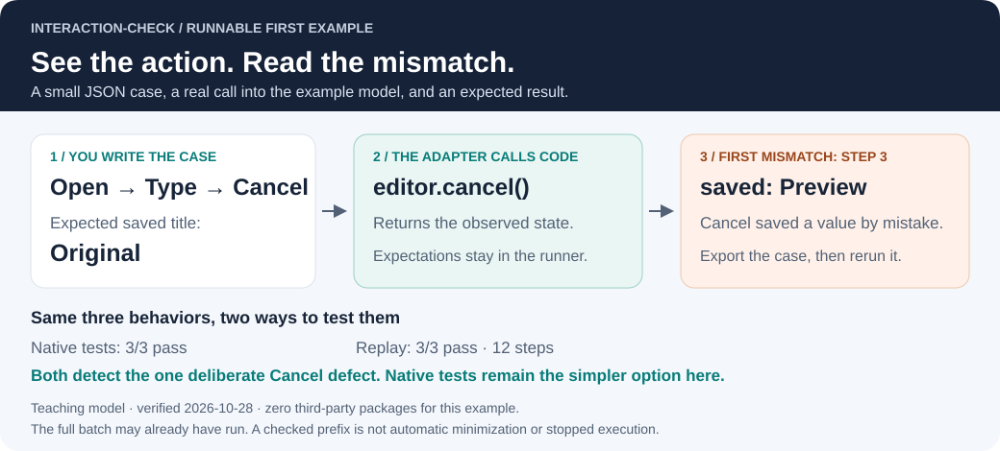
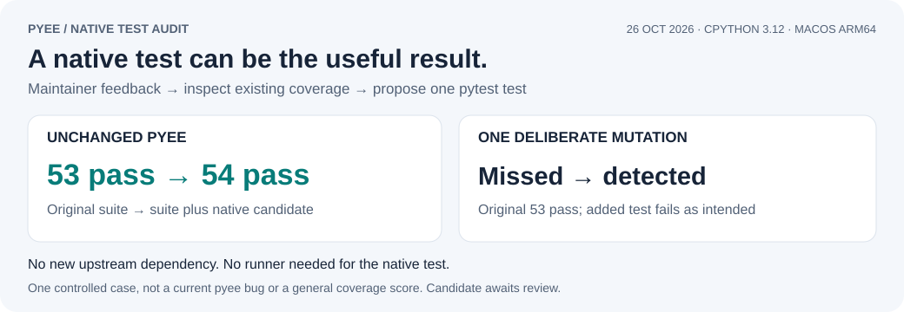

# interaction-check

Describe actions such as Open → Type → Cancel in JSON, call your code through a small
adapter, and compare the returned state with your expectations. A standalone Python
development tool, with no runtime dependencies. Python 3.10+.

[](https://github.com/PerchAnton/interaction-check/actions/workflows/ci.yml)
[](https://github.com/PerchAnton/interaction-check/actions/workflows/evidence.yml)

**[First example](#try-it-without-an-application)** · **[When to use it](docs/CHOOSING.md)** · **[Install](#install-the-released-command)** · **[Report a failure](docs/REPORTING.md)** · **[Evidence](#evidence-and-trade-offs)**

## Try it without an application



From a checkout of this repository, run:

```sh
python examples/quickstart/verify.py
```

No package installation is needed. The command tests a small in-memory title editor,
breaks Cancel **in a temporary copy**, exports the failing case and reruns it. It also
runs equivalent ordinary Python tests. An expected `FAIL` is followed by `Verified`;
the command exits successfully only when the whole demonstration checks out.

**Recorded 27 October 2026:** 3 native tests and 3 replay scenarios / 12 steps pass
on the correct model. Both detect the same deliberate Cancel defect. This is an
original teaching example, not an upstream bug or a claim of additional coverage.
[Read the code and commands](examples/quickstart/README.md) · [Raw evidence](docs/evidence/quickstart.json).

The adapter translates actions into calls and returns state; it does not receive
expected values. The runner compares states after the adapter runs. **The full batch
may already have executed when the first mismatch is reported.** Export saves a
checked prefix, which must be rerun; it does not automatically minimize a failure.

| Your need | Start here |
| --- | --- |
| Check behavior inside one project | Its ordinary test framework; the example includes [native tests](examples/quickstart/native_tests.py) |
| Share an action sequence and a consistent mismatch report | Evaluate this runner, including the cost of writing and maintaining an adapter |
| Test actual mouse input, rendering or a GUI widget | Your application's UI harness; a model adapter does not establish GUI behavior |
| Protect a Rust draft from stale document changes | Evaluate the separate [edit-session library](https://github.com/PerchAnton/edit-session); neither project requires the other |

[Choosing a tool](docs/CHOOSING.md) connects these decisions to maintainer feedback.
[A short useful bug report](docs/REPORTING.md) shows how to share one actionable failure.

## Read a real API trace

Current source includes **[property writes and callbacks](examples/dispatch/README.md)**,
[expected/observed Mermaid diagrams](examples/dispatch/trace.md), a
[deliberate first mismatch](examples/dispatch/mismatch.md), and ordinary native tests.
For terminal widgets, see [five rat-salsa calls and their limits](docs/REAL_API_WALKTHROUGH.md).
These examples are included in the **0.1.0a8 source archive**; the runner protocol
is unchanged. The optional renderer runs from source, not as a new CLI flag.

## Release 0.1.0a8 / alpha.8

This examples-and-documentation release adds the real-property walkthrough and optional
Mermaid reports. It keeps Python 3.10+, zero runtime dependencies, schema 1 and protocol 1.
The wheel installs the runner; the source archive includes both walkthroughs.

[PyPI version and files](https://pypi.org/project/interaction-check/0.1.0a8/) ·
[GitHub prerelease and checksums](https://github.com/PerchAnton/interaction-check/releases/tag/v0.1.0-alpha.8) ·
[Changes](CHANGELOG.md). The linked registry/release pages confirm publication status.
Validation covers 54 unit tests, the three native dispatch tests and five replay steps,
including the intentionally incorrect expectation. No upstream defect or speedup is claimed.

## Previous publication: alpha.7

**[0.1.0a7 on PyPI](https://pypi.org/project/interaction-check/0.1.0a7/) · published 27 October 2026 (Europe/Kyiv) · Python 3.10+**

**[GitHub prerelease and checksums](https://github.com/PerchAnton/interaction-check/releases/tag/v0.1.0-alpha.7)** · **[Wheel and source archive](https://pypi.org/project/interaction-check/0.1.0a7/#files)** · [SHA-256 and installation evidence](docs/evidence/release-alpha7.json) · [Changelog](CHANGELOG.md) · [Tagged source](https://github.com/PerchAnton/interaction-check/tree/v0.1.0-alpha.7)

<details>
<summary>Published package snapshot and verification</summary>


Release snapshot: **49 runner tests**, **0 runtime dependencies**, **12.9 KiB wheel
(13,227 bytes)**. [Exact files, hashes, release CI and clean installation](docs/evidence/release-alpha7.json).
These are dated release facts; the CI badges above track current main. The handoff is
manual, and an export must be replayed before sharing. The wheel installs the runner;
the source archive includes the complete first example. Application adapters remain separate.

</details>

Trying the alpha? [Report a bug](https://github.com/PerchAnton/interaction-check/issues/new?template=bug_report.yml)
with your runner and adapter versions, or read the [alpha compatibility policy](docs/RELEASING.md#alpha-compatibility).

## Install the released command

Install the exact published prerelease from PyPI in a virtual environment:

```sh
python -m venv .venv
.venv/bin/python -m pip install 'interaction-check==0.1.0a8'
.venv/bin/interaction-check --version
```

On Windows use `.venv\Scripts\python.exe` and `.venv\Scripts\interaction-check.exe`.
For a source checkout, use `python -m pip install .` inside your virtual environment.
The exact pin selects this alpha without opting into all future prereleases. Installation
from PyPI, metadata, all three quickstart scenarios, deliberate failure detection,
export and replay were checked in a fresh environment. The [previous GitHub release](https://github.com/PerchAnton/interaction-check/releases/tag/v0.1.0-alpha.5)
remains available. Start with the
[dependency-free first example](examples/quickstart/README.md), then the
[XState walkthrough](examples/xstate/README.md) or [native-test guide](docs/NATIVE_TESTS.md).

## Evidence and trade-offs

<details>
<summary>Open measured results, comparisons and sources</summary>


### The numbers behind the overview

Evidence snapshot: **26 October 2026**. CI badges are live; the graphic and counts are
dated results. The runner count includes eight alpha 5 export/CLI tests; Node,
PdfCraft and timing figures retain their earlier 26 October evidence. Package counts describe the example installation; timings describe the
same three example scenarios on one macOS arm64 machine.

| Measure | Recorded result | Source and scope |
| --- | --- | --- |
| Runner Python dependencies | **0 third-party packages** | [Runner source](interaction_check.py); adapters have their own requirements |
| Verification tests | **49 Python + 6 Node pass** | [Runner checks](docs/VALIDATION.md), [native example tests](examples/xstate/native.test.mjs), [adapter tests](examples/xstate/adapter.test.mjs) |
| Real PdfCraft replay | **10 scenarios / 79 steps pass** | [State report](docs/evidence/pdfcraft-alpha4.json); real widgets and engine, proposed integration |
| Focused XState installation | **120 → 1 package entries; −99.2%** | [Lockfile comparison](docs/VALUE.md#a-smaller-installation-for-one-example); excludes unrelated examples and formatter; XState is unchanged |
| Median / p95 execution time | **Native: 74.6 / 80.5 ms; replay: 183.9 / 191.9 ms** | [30 paired samples](docs/evidence/xstate.json), [method](docs/VALUE.md#measured-execution-overhead); startup included, install and JSON report writes excluded |
| Controlled example mutations | **3/3 detected by both methods** | [Three deliberate defects](docs/VALUE.md#does-it-detect-wrong-behavior); not upstream bugs or a general coverage score |

Replay is **2.46× slower** in this small pilot. Its value is a shareable trace and common
failure report. Native tests also need only XState; fewer total lines of code or faster
application behavior are not demonstrated.

**Experimental, 0.1.0a7 (alpha 7), available on PyPI.** Maintained by [PerchAnton](https://github.com/PerchAnton).
Upstream adoption is not claimed. The first adapter uses a fixed
edit-session revision and commits through PhotoCraft's actual `Session` command API;
consumer-owned adapters also exercise the real PhotoCraft and PdfCraft dialogs.

</details>

## A useful outcome can be one native test

<details>
<summary>Pyee: one native candidate catches a deliberate mutation missed by the original suite</summary>



Following [maintainer feedback](https://github.com/jfhbrook/pyee/issues/226#issuecomment-6409488443),
we checked the full pyee suite and translated one external trace into a native pytest
candidate. On the pinned source: **53/53 existing tests pass; 54/54 with the candidate**.
One deliberate local mutation escapes the original suite but is caught by the added test.
The candidate needs **no new dependency** in pyee and no interaction-check runner.

[Test, method, raw results and reproduction](examples/pyee/README.md).
This is one demonstrated coverage gap, not a current pyee bug, a general coverage score
or upstream adoption. These are pyee suite counts, separate from our 49 runner tests.

</details>

## Start with one reviewable reproduction

The [XState walkthrough](examples/xstate/README.md) includes three small traces, the
expected state after every event and a failure you can reproduce. Its focused install
contains **1 npm package instead of the 120 entries in our earlier multi-consumer
lockfile**. The Python runner itself still uses only the standard library.

Use `--trace --report result.json` to retain each checked event, expectation and actual
state. A failing report includes the checked prefix and the first mismatching state.
This makes a regression report readable before someone runs the reproduction.

[Measured value and trade-offs](docs/VALUE.md) includes native tests, source counts,
30 paired timing samples and three controlled mutations. Both test paths detect all
three mutations; native tests are shorter and faster here. The reason to choose replay
is a shareable trace and common report format. Upstream adoption remains unconfirmed.

## Proposed PhotoCraft UI consumer

[PhotoCraft PR #9190](https://github.com/storytold/photocraft/pull/9190) adds a PhotoCraft-owned
adapter that drives the shipped Edit Selected Guides dialog, egui canvas/dialog frames, control
field setter and real Session. Its CI fetches this runner at
`f8d4282d61576ffe78d18553c642d215887e2d9f`; Python is not an application runtime dependency.
[Ten scenarios / 44 steps](https://github.com/PerchAnton/photocraft/tree/46b4a183d5f44035bbc216dcf6196701bcb45bc9/tests/interactions/guide-edit)
pass locally, covering preview, commit, Cancel/Escape, invalid input, no-ops and stale drafts.
This consumer patch is awaiting maintainer review; upstream adoption is not claimed.

## Proposed PdfCraft UI consumer

[PdfCraft PR #4594](https://github.com/storytold/pdfcraft/pull/4594) uses this runner for **Document Properties**.
Its runtime draft lifecycle uses edit-session; this runner checks the resulting UI and engine state.
Description, Initial View and Custom values share a draft bound to document identity,
edit generation and permissions. `check_live` rejects stale input after edits, Undo/Redo,
reload or a document switch; the existing engine commits one atomic batch. Cancel,
Escape and no-ops do not add history. Failed engine edits retain the form for correction.
Clean inspection tabs retain their existing live refresh without rebasing typed input.

The consumer owns a [real UI adapter](https://github.com/PerchAnton/pdfcraft/blob/535d990d10832baf3b0a64910c51b280c224bd5c/crates/ui-egui/examples/properties_scenarios.rs)
and [10 scenarios / 79 steps](https://github.com/PerchAnton/pdfcraft/tree/535d990d10832baf3b0a64910c51b280c224bd5c/tests/interactions/document-properties),
replayed by interaction-check, including save/reopen and preservation of custom metadata.
Local scoped UI tests, strict Clippy, assets, parity and wasm checks pass. Both dependencies
are pinned; upstream review of the source-policy exception and adoption is pending.
See [reproduction instructions](https://github.com/PerchAnton/pdfcraft/blob/535d990d10832baf3b0a64910c51b280c224bd5c/docs/document-properties-sessions.md).

## Run

Requires Python 3.10+ (tested with Python 3.14 on macOS arm64).

```sh
python3 -m unittest -v
cargo build --locked --manifest-path adapters/photocraft/Cargo.toml
python3 interaction_check.py --report result.json --junit result.xml scenarios/photocraft/*.json -- \
  adapters/photocraft/target/debug/edit-session-photocraft-probe
```

The Rust adapters need Rust 1.99+ (tested with 1.99.1). For the bundled PhotoCraft adapter,
Cargo fetches both Rust repositories at fixed commits; no sibling checkout or path override is required.
See the [adapter README](adapters/photocraft/README.md). Each scenario starts a fresh process. Exit 0
means all scenarios passed and requested reports were written; 1 means a scenario or report
write failed; invalid CLI usage exits 2.

## Reports for CI

Add `--trace` with `--report FILE` for per-step JSON evidence. Each entry has `step`
(1-based), `event`, `expect`, `actual`, and `passed`; a mismatch also has `differences`.
Only checked steps up to the first mismatch are included. Later events may already have
executed: this is post-execution checking, not stop-on-first-failure execution. Malformed
replies have no invented state; process crashes/timeouts do not produce a checked trace.
The option does not change JSONL requests, default compact reports, or JUnit output.
Reports include the event/state values chosen by the adapter; review them before sharing.

`--report FILE` writes JSON and `--junit FILE` writes JUnit XML; either or both are optional.
JUnit contains one test case per scenario, failure details and captured adapter stderr,
including failed assertions, invalid replies, nonzero exits and timeouts. The Python API
exposes these diagnostics as `CheckError.stderr`; JSON reports use `stderr`, and JUnit
uses `system-err`. Scenario failures keep their declared name and source path in both formats. If the
input cannot be parsed, its filename is used instead. A failed scenario does not prevent
the remaining scenarios from running or the reports from being written.

Each report is replaced atomically after a complete write. Create parent directories first.
Report paths that refer to a scenario input or to the other report (including existing
symlinks/hard links) are rejected before starting an adapter. Report write failures produce
a diagnostic on stderr and exit 1, even when every scenario passed. Characters forbidden by
XML 1.0 are replaced with U+FFFD in JUnit; the JSON report preserves the original strings.

## Export a failure and keep a native test

```sh
python3 interaction_check.py --failure-dir failures --report report.json scenario.json -- path/to/adapter
python3 interaction_check.py failures/0001.json -- path/to/adapter
```

`--failure-dir` creates a new directory and writes each failing scenario through its
first state mismatch. It preserves expectations and metadata; JSON reports link to
the saved files. Numbered filenames follow input order. Successful runs create no
scenario files. Existing directories are refused to avoid mixing old and new failures.

The export is a checked prefix, not an automatically minimized or rerun reproduction.
Re-run it with the same adapter revision. Crashes, timeouts and protocol errors keep
their diagnostics instead of exporting a guessed assertion failure. The
[native-test guide](docs/NATIVE_TESTS.md) shows how to move useful pyee and XState
behavior into the consumer's normal tests, without retaining a runner dependency.

## Scenario format

```json
{
  "schema": 1,
  "name": "Cancel a preview without changing history",
  "steps": [
    {"event": {"op": "begin"}, "expect": {"undo_depth": 0, "error": null}},
    {"event": {"op": "preview", "value": 0.5},
     "expect": {"committed": 1, "preview": 0.5, "undo_depth": 0, "error": null}},
    {"event": {"op": "cancel"},
     "expect": {"committed": 1, "preview": null, "undo_depth": 0, "error": null}}
  ]
}
```

Each request is a JSON line with `protocol: 1`, an integer `id`, and `event`.
The adapter returns exactly one JSON line per request with the same `protocol`/`id` and a
`state` object, then exits at stdin EOF. Logs go to stderr. Expectations are never sent to
the adapter. Objects match recursively by expected fields, including objects inside arrays.
Arrays must have the same length and order; each element uses the same matching rules.
Booleans are distinct from numbers. Missing fields are distinct from null.
Non-finite numbers, duplicate keys, missing/extra replies, wrong IDs, adapter crashes,
timeouts and malformed JSON fail the run.

JSONL records are separated by LF (CRLF also works), with an optional final newline.
Unicode line separators inside a JSON string are data, not record boundaries. Extra blank
lines are invalid. Inputs and replies allow at most 64 nested objects/arrays and must use
Unicode scalar values (no unpaired surrogates); malformed data fails with a diagnostic.

The whole scenario's events are sent in order. The adapter must process them sequentially
and finish each event before replying. This is semantic replay, not timed pointer playback.
Use a custom adapter to translate events into `egui_kittest` interactions or an app protocol.

## Existing tools and scope

Keep `egui_kittest` for widget/accessibility/pixel tests, `teatest` for Bubble Tea, and
`proptest` for input generation. This prototype adds a portable trace plus explicit assertions
and a machine-readable report; it does not replace those tools or discover bugs by itself.

The bundled engine-only PhotoCraft adapter drives real commands and history in a headless process. It does
not connect to the live application's UI or test its renderer, saved files or native input.
Upstream adoption is pending. The [PdfCraft adapter](adapters/pdfcraft/README.md) is owned
by the consumer repository and also uses engine save/reopen. No Bubbles adapter,
auto-recording or shrinking is implemented.

Adapters are trusted local test programs, launched without a shell. A per-scenario timeout
defaults to five seconds. Input is limited to 1 MiB. Stdin and output capture use temporary
files so a non-reading adapter cannot block input delivery and logs do not grow in RAM.
While the adapter runs, stdout and stderr sizes are checked about every 50 ms; either
stream exceeding 1 MiB stops the adapter. A final check also catches fast-exiting writers.
At most 1 MiB of stderr is retained in a failure report.

Polling is not a hard disk quota: a fast writer can overshoot between checks. This is not
a sandbox. Timeout, output-limit handling and cancellation stop and reap the direct
adapter process, not a tree of spawned descendants. Adapters must manage their children.

## Evidence

- [PdfCraft UI report](reports/pdfcraft-properties.json): ten scenarios / 79 steps; see the
  [adapter instructions](adapters/pdfcraft/README.md) for immutable source pins and replay.

- [Alpha 2 review and regression checks](docs/VALIDATION.md): Unicode JSONL, report safety,
  JUnit, bounded JSON nesting and compatibility with existing PhotoCraft adapters.
- [Current PhotoCraft Session scenarios](photocraft-session-report.json): eight scenarios,
  41 steps, using the published Git dependency and real command dispatch. Each step also
  checks the command journal count, so previews and no-op commits cannot silently send edits.
- [Earlier PhotoCraft component scenarios](photocraft-report.json): eight scenarios against
  the original Document/History adapter, before switching to Session dispatch.
- [Earlier deliberate mutation](mutation-report.json): expected failures after disabling context
  protection in a temporary library copy. Stale-target and undo-back-to-original scenarios
  detect a wrong document mutation/history change. A third scenario detects the changed error.
- [Detailed validation](https://github.com/PerchAnton/edit-session/blob/main/docs/VALIDATION.md).

The same runner now passes real UI scenarios in both proposed consumers. The next milestone
is maintainer review of their behavior and dependency policy; this is not a claim of upstream adoption.

## License

Licensed under either the [MIT license](LICENSE-MIT) or the
[Apache License, Version 2.0](LICENSE-APACHE), at your option.
Unless explicitly stated otherwise, contributions submitted for inclusion are offered
under the same dual license.
