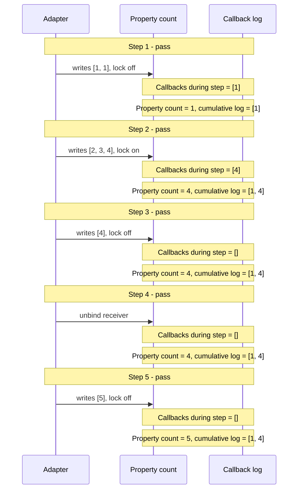

# Property notification trace

Only checked steps are shown; the adapter may have executed the full batch.
Writes are requested assignments. Callbacks are the new suffix of the cumulative log.
`count` is the property value, **not** the number of callbacks.
The diagrams summarize each step; they do not assert intra-step timing.

## Expected

| Step | Requested action | New callbacks | Cumulative log | Property count | Check |
| --- | --- | --- | --- | --- | --- |
| 1 | writes [1, 1]; lock off | [1] | [1] | 1 | pass |
| 2 | writes [2, 3, 4]; lock on | [4] | [1, 4] | 4 | pass |
| 3 | writes [4]; lock off | [] | [1, 4] | 4 | pass |
| 4 | unbind receiver | [] | [1, 4] | 4 | pass |
| 5 | writes [5]; lock off | [] | [1, 4] | 5 | pass |

## Observed

| Step | Requested action | New callbacks | Cumulative log | Property count | Check |
| --- | --- | --- | --- | --- | --- |
| 1 | writes [1, 1]; lock off | [1] | [1] | 1 | pass |
| 2 | writes [2, 3, 4]; lock on | [4] | [1, 4] | 4 | pass |
| 3 | writes [4]; lock off | [] | [1, 4] | 4 | pass |
| 4 | unbind receiver | [] | [1, 4] | 4 | pass |
| 5 | writes [5]; lock off | [] | [1, 4] | 5 | pass |

